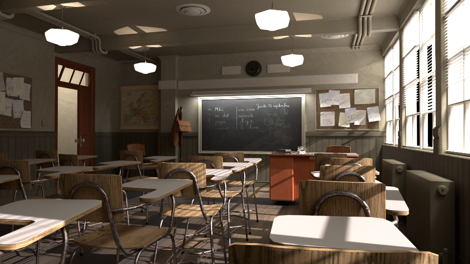
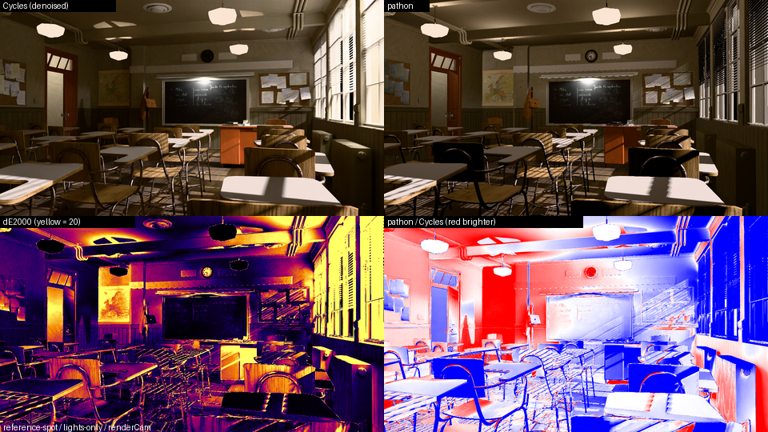
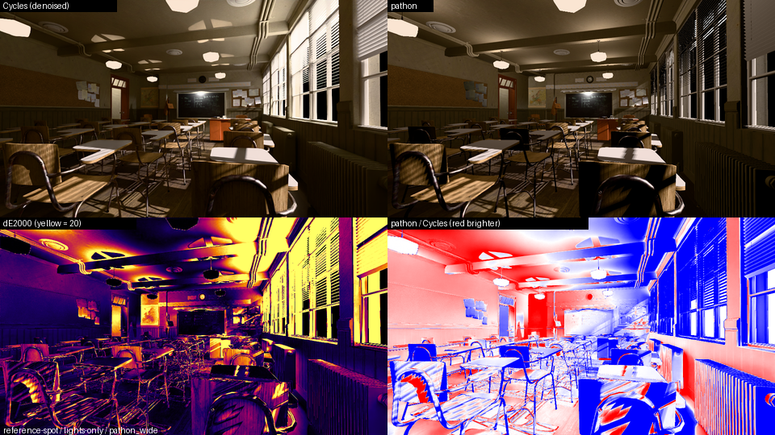
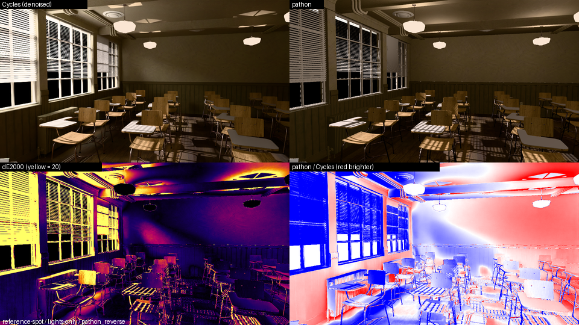
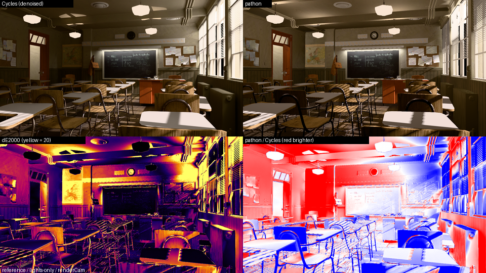
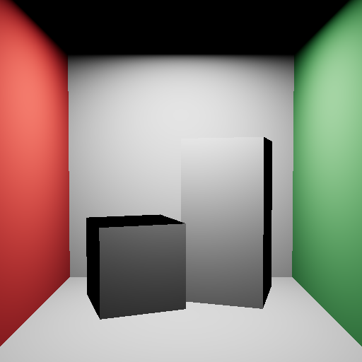
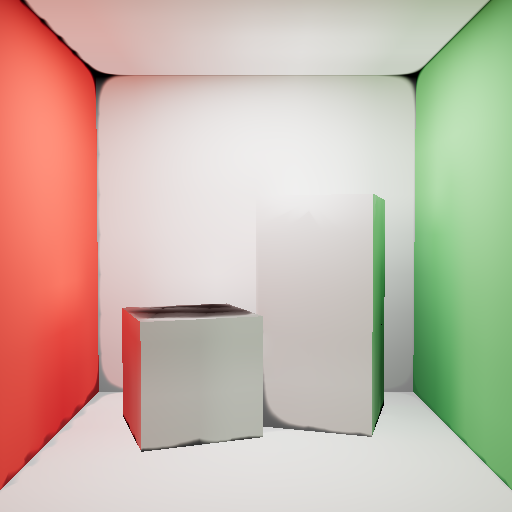
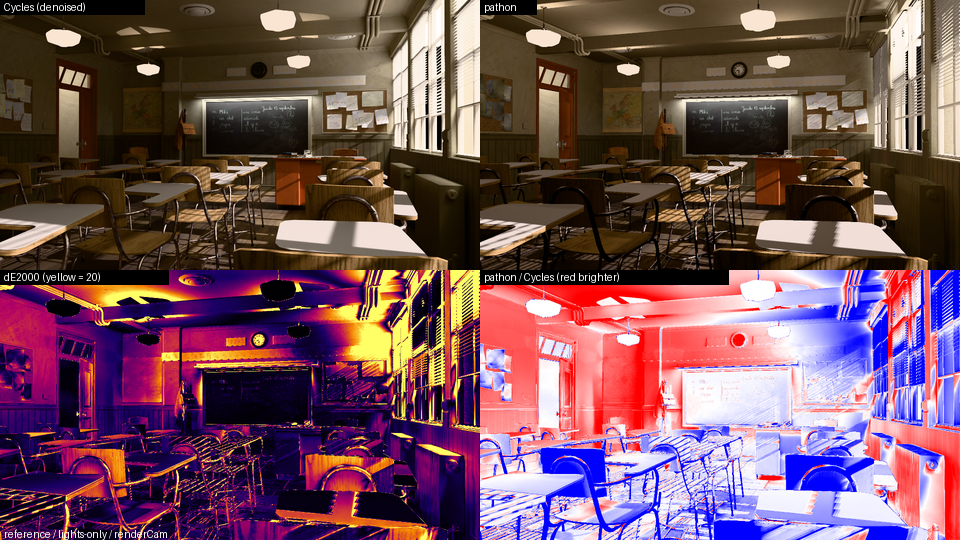
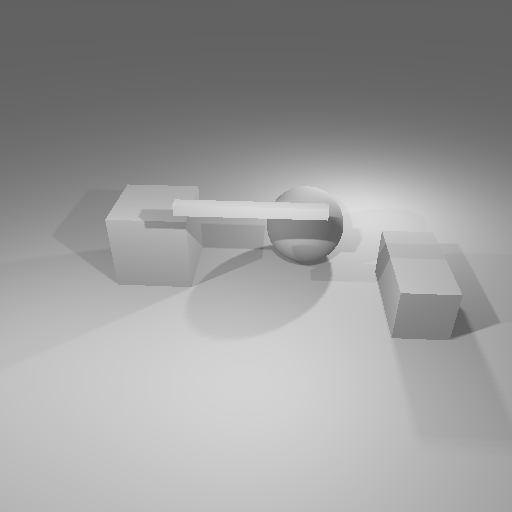

# Porównanie obrazu pathon z Cyclesem (K01)

Stan na 25.11.2026. Protokół mierzenia, jak daleko obraz pathon jest od ścieżkowego renderu Blendera tej samej sceny. Opis scen: [scenes.md](scenes.md); uzasadnienie i kontekst (wzorce A i B, lista technik): [filament-reference.md](filament-reference.md#protokół-porównania-z-cyclesem-scena-classroom). Tu jest część praktyczna: polecenia, ustawienia, jak czytać liczby i pierwsze wyniki wzorca.

Zrobione w K01: render wzorca w Blenderze (`tools/scenes/render_reference.py`), komparator (`tools/scenes/compare.py`), strona pathon (`gltf_viewer --dump-hdr … --reference-like …`, [Strona pathon](#strona-pathon)), polecenie `python tools/scenes/compare_all.py` uruchamiające całość i **pierwszy pomiar renderera** ([Pierwszy pomiar pathon](#pierwszy-pomiar-pathon)). Progi zielone/żółte/czerwone są skalibrowane na tym pomiarze ([Progi](#progi-zielone-żółte-czerwone)).

## Wymagania

| Element | Wersja / uwagi |
| --- | --- |
| Blender | 5.2.2 LTS, `C:\Program Files\Blender Foundation\Blender 5.2\blender.exe` (katalog „Blender 4.5” nie ma `blender.exe`). API 5.x: obraz wielowarstwowy ustawia się przez `image_settings.media_type`, nie przez `file_format` |
| GPU | AMD Radeon RX 9070 XT przez HIP z HIP RT (skrypt wybiera HIP, potem OptiX, CUDA, oneAPI, na końcu CPU). Na tej maszynie jest też GTX 1650 SUPER (CUDA): jest wyłączona, żeby nie mieszać urządzeń |
| Python | 3.11 z `numpy` i `Pillow` (wystarczą do `compare.py`; Blender używa własnego Pythona) |
| FLIP (opcjonalnie) | `pip install flip-evaluator` w venv (BSD-3-Clause, [NVlabs/flip](https://github.com/NVlabs/flip), sprawdzone 25.11.2026: LICENSE „BSD 3-Clause”, klasyfikator PyPI „BSD License”). `compare.py` używa go, jeśli jest zainstalowany, inaczej pomija pole `flip`. Nie jest zależnością Cargo ani nie wchodzi do repozytorium |

Nic nie instalujemy globalnie; do FLIP wystarczy `python -m venv --system-site-packages .venv-flip && .venv-flip/Scripts/pip install flip-evaluator` poza repozytorium.

## Krok 1: render wzorca

Wzorzec B z [filament-reference.md](filament-reference.md): **ten sam `classroom.glb`, który wczytuje pathon**, zaimportowany do pustej sceny Blendera (importer glTF), więc różni się tylko renderer, nie zawartość. Źródłem jest wyeksportowany plik, nie `classroom.blend`, żeby nie mieszać strat eksportu ([scenes.md](scenes.md#materiały-principled-bsdf-i-straty)) z różnicami renderera.

```sh
blender -b --factory-startup --python tools/scenes/render_reference.py -- test-assets/classroom/reference \
  --glb test-assets/classroom/classroom.glb --samples 4096 --calibrate-exposure
```

(`--factory-startup` i pusty plik są potrzebne, bo skrypt sam czyści scenę; nie trzeba podawać `.blend`.) Opcje:

| Opcja | Domyślnie | Znaczenie |
| --- | --- | --- |
| `--cameras` | `renderCam,pathon_wide,pathon_reverse` | nazwy obiektów kamer z `.glb` |
| `--lighting lights-only\|ibl\|both` | `both` | `lights-only`: świat czarny (jak w oryginale), `ibl`: świat z `env/Garage.hdr` |
| `--samples` | 512 | próbki na piksel; wzorzec zapisany tu to 4096 |
| `--denoise off\|on\|both` | `both` | `off`: tylko surowy render (z AOV), `on`: tylko OpenImageDenoise, `both`: dwa rendery na kamerę |
| `--resolution` | `960x540` | rozdzielczość; to samo co zrzuty pathon (`--size 960x540`) |
| `--area-lights real\|spot` | `real` | `real`: prostokątne światła obszarowe z `extras.pathon_area`; `spot`: półsferyczne spoty z `.glb`, czyli to, co dziś rysuje pathon |
| `--device auto\|hip\|optix\|cuda\|cpu` | `auto` | urządzenie Cyclesa |
| `--clamp-indirect` | 0 | 0 wyłącza obcinanie, patrz [Ustawienia](#ustawienia-wzorca) |
| `--exposure-ev` | 0 | tylko pliki PNG; EXR zawsze surowy |
| `--ibl-strength` | 1 | siła świata w wariancie `ibl` |
| `--no-aovs` | wyłączone | bez dodatkowych przebiegów |
| `--calibrate-exposure` | wyłączone | najpierw zmierz radiancję białej płaszczyzny pod słońcem i zapisz do `reference.json` |

Wynik w `<out_dir>/<lighting>/`: `<kamera>.exr` (wielowarstwowy, liniowy Rec.709, float32, bez odszumiania, z AOV), `<kamera>.png` (ten sam obraz jako sRGB, transformacja Standard), `<kamera>_denoised.exr` i `.png`; w `<out_dir>/reference.json` komplet ustawień (wersja Blendera, urządzenie, próbki, ziarno, ścieżki światła, kamery, światła po imporcie, mapowanie materiałów na indeksy, czasy, suma SHA-256 `.glb`). Katalog jest w `test-assets/` (poza gitem; ok. 45 MB na plik z AOV).

### Ustawienia wzorca

| Ustawienie | Wartość | Dlaczego |
| --- | --- | --- |
| Silnik | Cycles, GPU (HIP RT), 4096 próbek, **bez** adaptacyjnego próbkowania, ziarno 0 stałe | powtarzalność; 4096 jak w protokole |
| Odbicia | łącznie 16, diffuse 8, glossy 8, transmisja 12, przezroczystość 16, objętość 0 | z protokołu |
| Kaustyki | wyłączone (odbite i załamane) | pathon ich nie ma |
| Obcinanie indirect (`clamp indirect`) | **wyłączone** | domyślne 10 w Blenderze **zaniża średnią jasność o ok. 21%** (zmierzone na `renderCam`, 512 próbek: 0,257 przy 10, 0,322 przy 30, 0,326 przy 100 i przy 0); obcinanie ucina światło z silnych, małych źródeł (lampa za oknem o 213 437 cd), czyli właśnie to, co mierzymy. Cena: surowy obraz ma świetliki, dlatego strukturę mierzymy na wersji odszumionej |
| Filtr piksela | Box, szerokość 1 px | piksel to zwykła średnia z jego pola, jak w zrzucie pathon z `--supersample` (zamiast renderu w 2× i uśredniania) |
| Rozdzielczość | 960×540 | jak zrzuty z `docs/scenes/`; protokół w filament-reference mówił o 1920×1080 z referencji 2×, to jest cenowo lżejsza zamiana |
| Kolor | transformacja widoku `Standard`, look `None`, ekspozycja 0, gamma 1, wyświetlacz sRGB; EXR liniowy | bez Filmic/AgX |
| Kamery | obiekty z `.glb` (pozycja, orientacja, `yfov` jak w pathon; zgodność `yfov` sprawdzana w `reference.json`) | `renderCam` w `.glb` leży o 2 mm (x) i 7 mm (z) od pozycji z `*.scene.json`; używamy `.glb`, bo tak robi loader pathon |
| Światła | importer glTF w trybie SPEC (odwrotność eksportu: lux → W/m², kandela → W przez 683), promień 0, więc ostre cienie jak w pathon; prostokąty obszarowe z `extras.pathon_area` | patrz [Jednostki](#jednostki-i-stała-kalibracyjna) |
| Świat `lights-only` | czarny, siła 0 | jak oryginał |
| Świat `ibl` | `Garage.hdr` (równoprostokątny, 2000×1000), siła 1, filtrowanie liniowe, **obrót Z = −90°** | patrz niżej |
| Odszumianie | OpenImageDenoise na GPU, tylko dla plików `*_denoised.*` | `.exr` bez przyrostka jest zawsze surowy |

Obrót świata: pathon mapuje środek obrazu równoprostokątnego na kierunek −Z (glTF), z `u` rosnącym ku +X ([pathon-ibl](crates/pathon-ibl.md), `equirect_direction`). Cycles ma środek obrazu na +X (Blender, Z w górę). Po konwersji osi to przesunięcie o 90°; znak sprawdzony pomiarem: kamera 0,5° patrząca w cztery kierunki zwraca tę samą radiancję co teksel `Garage.hdr` w odpowiednim `u` (środek, `u` = 0,25, 0,75, 0). Wartości z `Garage.hdr`: średnia luminancja 0,148, maksimum 78,8 (mały jasny obszar), jest więc ciemny i ma niewielki wkład w tej scenie (patrz niżej).

Okna: obiekty `dayLight_portal` zostały pominięte przy eksporcie, więc w wariancie `lights-only` okna pokazują czerń (otwory w ścianie), a w `ibl` widać przez nie `Garage.hdr`.

### Jednostki i stała kalibracyjna

- **Słońce:** 15 W/m² w Blenderze to 10 245 lx w glTF (15 · 683). Zmierzone w Blenderze 5.2.2: biała powierzchnia Lambert o albedo 1 pod słońcem 15 W/m² daje radiancję 4,7746 = 15/π (stosunek zmierzone/oczekiwane 1,000000).
- **Światło punktowe:** P watów w Blenderze to P/(4π) W/sr (izotropowo, bez dodatkowego π); zmierzone na płaszczyźnie: `L = P/(4π²h²)`, czyli `E = P/(4π h²)`. glTF: kandela = P/(4π)·683, więc po ekspozycji 1/683 jednostki są te same.
- **Światło obszarowe:** prostokąt o mocy P jednostronny Lambert, natężenie osiowe P/π W/sr (zmierzone). Spot z `.glb` (półsferyczny, strumień zachowany) ma P/(2π), czyli **o połowę mniej na osi**; to znana różnica pathon przed K05 (światła powierzchniowe).
- **Stała kalibracyjna: K = 1, ekspozycja pathon 1/683.** `radiancja_Blender = radiancja_pathon_przed_ekspozycją / 683`. Wyznaczona raz (`--calibrate-exposure` zapisuje pomiar do `reference.json`) i **nie dostrajana per obraz**. Emisja materiałów: Blender podaje ją w W/m²/sr jako radiancję, glTF w nitach (cd/m²), więc pathon musi traktować `emissive · emissive_strength` z mnożnikiem 683 przed ekspozycją (tak robi viewer). Rozbieżność „czynnik rzędu π” z [scenes.md](scenes.md) **nie występuje**: konwencje eksportu i importu są odwrotne, światła zgadzają się co do jednostki.

## Strona pathon

`gltf_viewer` zapisuje liniowy slot `hdr` bez tonemappingu (szczegóły w [examples.md](examples.md#viewer-sceny-testowej-gltf_viewer)):

```sh
cargo run --release -p pathon-examples --bin gltf_viewer -- test-assets/classroom/classroom.glb \
  --camera-name renderCam --reference-like lights-only --dump-hdr out/lights-only_renderCam.npy --size 960x540 --supersample 2 --backend vulkan
```

| Wymaganie wzorca | Jak spełnia je pathon |
| --- | --- |
| Plik | `.npy` float32 `[540, 960, 3]`, wiersz 0 u góry, liniowy Rec.709; nagłówek NPY 1.0 pisze `viewer::npy` (bez zależności), test w `cargo test -p pathon-examples --lib`; `np.load` w `compare.py` czyta go bez zmian |
| Bez tonemappingu, ekspozycja 1/683 | `Tonemapper::Linear` w `pathon-post` (bez krzywej i bez obcinania z góry) na celu `Rgba16Float`, ekspozycja ręczna `2^-ev = 1/683`, odczyt połówek zmiennoprzecinkowych do f32 (błąd względny 2^-11, czyli 0,05%). Zapisany obraz to dokładnie `hdr × 1/683` z passów pbr, więc `--test-scale` zostaje 1 |
| Kamery | `--camera-name` (`renderCam`, `pathon_wide`, `pathon_reverse`) albo indeks z logu: 0 = `pathon_reverse`, 1 = `pathon_wide`, 2 = `renderCam` (kolejność z `.glb`, **nie** jak `--cameras` wzorca). `yfov` z `.glb`, proporcje 960:540 |
| Bez ambientu, bloomu, auto-ekspozycji | `--reference-like` ustawia `ViewerSettings::reference_like`: bloom i ekspozycja automatyczna wyłączone; ambient istnieje tylko w trybie `--simple` |
| `lights-only` | siła środowiska (światło) i tła 0: okna pokazują czerń, jak świat Blendera |
| `ibl` | `env/Garage.hdr` obok sceny, siła światła i tła **683** (W/m²/sr Blendera → jednostki fotometryczne pathon), **bez obrotu świata**: konwencja `pathon-ibl` (środek obrazu na −Z) jest równoważna obrotowi Z = −90° we wzorcu |
| Antyaliasing | `--supersample N` renderuje N razy większy obraz i uśrednia bloki N×N w świetle liniowym (filtr box 1 px, jak wzorzec); protokół używa N = 2 |
| Światła, cienie | bez zmian względem viewera: światła `.glb` (lux, kandele), cień tylko od słońca, emisja ×683 |

**Weryfikacja jednostek i orientacji IBL na pikselach nieba.** W wariancie `ibl` wybrano piksele, w których przebieg `Environment` Cyclesa to ponad 90% jasności (czyste tło widoczne przez otwory okien): pathon daje tam **0,99 / 0,99 / 0,94** jasności Cyclesa (`renderCam` / `pathon_wide` / `pathon_reverse`, 1234 do 6142 pikseli), korelacja przestrzenna 0,99 / 0,89 / 0,92. Skala 683 i orientacja bez obrotu są więc zgodne; odchylenie 6% w `pathon_reverse` nie zostało zbadane. Emisja (lampy) ma bias 1,00 we wszystkich kamerach, a podświetlenie tablicy 0,91 do 1,08: **ekspozycja i jednostki nie są źródłem błędu.**

## Krok 2: porównanie

**Całość jednym poleceniem** (buduje `gltf_viewer`, renderuje 3 kamery × `lights-only` i `ibl`, porównuje z `reference-spot/` i `reference/`, zapisuje `out/k01/summary.md` z tabelami gotowymi do wklejenia do PR-a techniki):

```sh
python tools/scenes/compare_all.py
```

Opcje: `--references reference-spot`, `--lightings lights-only`, `--cameras renderCam`, `--supersample N`, `--out-dir`, `--no-build`, `--no-render` (ponowne porównanie zapisanych `.npy`), `--raw` (surowy wzorzec), `--docs-dir docs/scenes/reference` (kolaże 960×540). Potrzebuje `numpy` i `Pillow` (FLIP, jeśli interpreter ma `flip_evaluator`) oraz katalogów wzorców w `test-assets/classroom/`. Poniżej to samo krok po kroku.


```sh
python tools/scenes/compare.py \
  --reference test-assets/classroom/reference/lights-only/renderCam_denoised.exr \
  --test wyniki/pathon_renderCam.npy --out-dir wyniki/renderCam --name renderCam
```

- Jako `--reference` użyj pliku `*_denoised.exr`: struktura (SSIM, FLIP) przy surowym renderze liczy też szum Cyclesa. Maski i udziały AOV `compare.py` bierze automatycznie z surowego `<kamera>.exr` obok, a mapowanie materiałów z `reference.json` powyżej w drzewie katalogów (`--reference-json` wymusza inne).
- `--test-scale` mnoży radiancję pathon (jedna stała z kalibracji, nie per obraz), `--exposure` mnoży oba obrazy przed tonemappingiem.
- `--synthetic direct-only|direct-flat-ambient` porównuje wzorzec z podzbiorem jego własnych AOV (patrz niżej); służy do zakotwiczenia progów i jako test narzędzia.
- Wyniki: `<nazwa>_metrics.json`, `<nazwa>_collage.png` (referencja | test | mapa ΔE2000 | stosunek luminancji w EV, czerwony = test jaśniejszy, niebieski = ciemniejszy, ±2 EV), `<nazwa>_delta_e.png`.

Czyta EXR bez `OpenEXR` (własny czytnik: skanowane linie, bez kompresji, ZIP, ZIPS; półprecyzja i float; wielowarstwowe, część wielu obrazów). Inne kompresje (PIZ, DWAA) zgłasza błędem.

### Metryki (co liczy `compare.py`)

Oba obrazy przechodzą ten sam tonemap **PBR Neutral** (Khronos) i kodowanie sRGB, żeby różnica operatorów nie weszła do wyniku.

| Metryka | Definicja | Jak czytać |
| --- | --- | --- |
| `psnr_db` | PSNR na obrazie po tonemapie, szczyt 1 | ogólna odległość; mało czuły na strukturę |
| `ssim` | SSIM, okno gaussowskie 11×11 σ = 1,5, na luminancji po tonemapie | struktura, cienie; **szum referencji go obniża** |
| `delta_e2000_mean` / `_p95` | CIEDE2000 po tonemapie do sRGB | wierność koloru i jasności; p95 łapie duże błędy lokalne (brak cienia, brak odbicia) |
| `flip` | NVIDIA ꟻLIP: `ldr_mean`, `ldr_p95` na obrazie po tonemapie, `hdr_mean`, `hdr_p95` na liniowym | błąd „postrzegany”; 0 = identyczne, 1 = skrajnie różne |
| `bias_total` | średnia luminancja liniowa pathon / wzorzec | błąd energii: < 1 za ciemno |
| `bias_without_windows` | to samo poza maską `windows` | okna to 6 do 9% pikseli i do połowy luminancji wzorca, więc ten bias pokazuje resztę sceny |
| `per_mask.<maska>.bias_linear`, `bias_ev`, `delta_e2000_mean` | to samo w masce | gdzie jest błąd; maski: `board`, `floor`, `windows` (ramy i żaluzje), `walls_ceiling`, `wood_furniture`, `metal`, `plastic_desk_tops` z indeksu materiału, oraz `direct_lit`, `direct_shadowed` (połowa pikseli o większym i mniejszym Diffuse Direct), `emissive` |
| `reference_energy_share` | udział terminów Cyclesa w luminancji obrazu | patrz [Co zawiera różnicę](#co-zawiera-różnicę) |

Nie ma jeszcze metryki „RMSE względne w paśmie Indirect Diffuse” z protokołu: wymaga osobnego przebiegu oświetlenia pośredniego po stronie pathon.

**Maski bez Cryptomatte.** Przebiegi Cryptomatte w EXR wymagają osobnego dekodera; zamiast tego każdy materiał dostaje stały `pass_index` (kolejność alfabetyczna nazw, mapa w `reference.json`), a przebieg Material Index daje maskę z dokładnością do piksela (piksel na styku dwóch materiałów ma uśrednioną, niecałkowitą wartość indeksu i wypada z maski).

## Pierwsze wyniki wzorca

Render 25.11.2026, Blender 5.2.2 LTS, RX 9070 XT (HIP RT), 4096 próbek, rozdzielczość 960×540, 12 renderów (3 kamery × 2 warianty światła × surowy i odszumiony). Jeden render surowy trwał 104 do 162 s, odszumiony 86 do 144 s (odszumiony to osobny render z tą samą liczbą próbek; GPU bywało współdzielone z innymi zadaniami), całość 22 minuty; import `.glb` 4,5 s; do szybkich prób wystarcza `--samples 512` (ok. 18 s na obraz) albo 16 próbek (12 s, razem z kompilacją jądra). `reference-spot` (1024 próbki, 12 renderów) trwał ok. 5 minut. Pliki: `test-assets/classroom/reference/` (wzorzec z prawdziwymi światłami obszarowymi) i `test-assets/classroom/reference-spot/` (1024 próbki, **te same półsferyczne spoty, które dziś rysuje pathon**; patrz niżej, dlaczego są dwa). Małe PNG w [scenes/reference/](scenes/reference/): `renderCam-lights-only.png`, `pathon_wide-lights-only.png`, `pathon_reverse-lights-only.png` (odszumione, 960×540) oraz `renderCam-direct-only.png` i `renderCam-indirect-only.png` (rozkład na światło bezpośrednie i pośrednie, surowe 4096 próbek).



### Co zawiera różnicę

Rozkład luminancji obrazu wzorca na terminy Cyclesa: `Combined = kolor · (bezpośrednie + pośrednie)` dla każdego płata (diffuse, glossy, transmisja) plus emisja i środowisko (przebiegi `Diffuse/Glossy/Transmission Direct/Indirect/Color`, `Emission`, `Environment`); suma terminów odtwarza `Combined`. Wartości w % luminancji obrazu, wariant `lights-only`:

| Kamera | Diffuse bezpośrednie | **Diffuse pośrednie** | Glossy bezpośrednie | Glossy pośrednie | Transmisja pośrednia | Emisja | Środowisko | **Razem pośrednie** |
| --- | ---: | ---: | ---: | ---: | ---: | ---: | ---: | ---: |
| `renderCam` | 35,3 | **50,6** | 3,7 | 4,1 | 0,4 | 6,0 | 0,0 | **55,1** |
| `pathon_wide` | 28,2 | **56,3** | 4,0 | 4,3 | 0,1 | 7,0 | 0,0 | **60,8** |
| `pathon_reverse` | 28,3 | **59,4** | 2,6 | 4,9 | 0,0 | 4,8 | 0,0 | **64,3** |

Wariant `ibl` różni się od `lights-only` o 0 do 4 punktów procentowych (środowisko 0,1 / 2,9 / 0,6%): `Garage.hdr` jest ciemny, a okna małe, więc w tej scenie IBL niemal nic nie dodaje (luminancja `ibl` względem `lights-only`: 1,006 / 1,035 / 1,007, ΔE2000 średnie 0,4 do 0,7, SSIM powyżej 0,98). **Wariant `ibl` słabo testuje IBL w classroom**; do tego trzeba innej sceny albo jaśniejszego HDR.

**Wniosek: classroom to wnętrze oświetlone w ponad połowie światłem odbitym.** 55 do 64% luminancji obrazu pochodzi z oświetlenia pośredniego, z czego niemal wszystko (51 do 59 punktów) to diffuse. W zacienionej połowie pikseli (poniżej mediany `Diffuse Direct`) światło bezpośrednie daje tylko 12 do 21% luminancji; w oświetlonej połowie wciąż 52 do 57%. Ramy okien i żaluzje (`windows`) mają 85 do 92% światła pośredniego, prawdopodobnie dlatego, że od środka widać ich stronę osłoniętą przed lampą za oknem (nie sprawdzano osobno). Oglądając `renderCam-direct-only.png` i `renderCam-indirect-only.png`: sam obraz bezpośredni to ostre plamy słońca i światło tablicy na czarnym tle, a pośredni nadaje pokojowi wygląd: jasna ściana przy oknach, wnętrze ławek i tablica odbijająca światło. Bez GI pokój wygląda jak scena nocna z latarką.

Żeby skwantyfikować, ile daje „prawie GI” i ile tylko jego brak, `compare.py` umie porównać wzorzec z jego własnym podzbiorem AOV (obrazy pomocnicze, bez pathon):

| Obraz pomocniczy | PSNR dB | SSIM | ΔE2000 średnie | ΔE2000 p95 | FLIP LDR średnie | FLIP HDR średnie | Bias jasności |
| --- | ---: | ---: | ---: | ---: | ---: | ---: | ---: |
| **Szum wzorca**: surowy 4096 vs odszumiony 4096 | 31,6 | 0,78 | 2,1 | 5,5 | 0,04 | 0,11 | 1,00 |
| **Szum 512 próbek** (tylko `renderCam`): surowy 512 vs odszumiony 4096 | 23,2 | 0,51 | 5,0 | 14,1 | 0,10 | 0,25 | 1,00 |
| **Stały ambient**: światło bezpośrednie + oświetlenie pośrednie zastąpione średnią z obrazu | 15,5 | 0,67 | 11,6 | 26,3 | 0,44 | 0,62 | 0,76 |
| **Bez GI**: tylko światło bezpośrednie i emisja | 11,4 | 0,39 | 17,0 | 66,8 | 0,45 | 0,82 | 0,40 |

(średnie z trzech kamer, `lights-only`, referencja odszumiona; wariant `ibl` daje liczby w granicach ±0,02 SSIM i ±0,2 ΔE). „Stały ambient” przybliża dawny ambient viewera: oddaje część energii (bias 0,76 zamiast 0,40), a mimo to jest daleko, bo **brakuje struktury**, nie tylko jasności (ciemne zakamarki, jaśniejsze strony zwrócone ku oknom). To orientacyjny punkt startu dla renderera bez GI, AO i cieni z lamp; rzeczywisty pomiar pathon może wypaść inaczej.

Gdzie błąd siedzi (kamera `renderCam`, `lights-only`, referencja odszumiona; bias = stosunek luminancji obrazu pomocniczego do wzorca w masce):

| Maska | Udział obrazu | Bias „bez GI” | Bias „stały ambient” | ΔE2000 „stały ambient” |
| --- | ---: | ---: | ---: | ---: |
| tablica | 4,9% | 0,89 | 1,11 | 2,7 |
| podłoga | 6,9% | 0,75 | 1,29 | 4,2 |
| okna (ramy, żaluzje) | 5,9% | 0,12 | 0,26 | 19,7 |
| ściany i sufit | 30,2% | 0,61 | 0,99 | 13,8 |
| drewno mebli | 24,8% | 0,55 | 1,53 | 8,9 |
| metal | 4,7% | 0,60 | 1,54 | 11,8 |
| blaty plastikowe | 7,3% | 0,69 | 1,00 | 3,4 |
| oświetlone bezpośrednio (połowa pikseli) | 45,0% | 0,57 | 0,78 | 7,3 |
| zacienione (połowa pikseli) | 55,0% | 0,21 | 0,82 | 14,1 |
| emisja (lampy) | 1,3% | 0,99 | 1,01 | 1,0 |

Stały ambient przejaskrawia drewno i metal (1,5×, bo wnętrza ławek są w rzeczywistości zaciemnione: tu trzeba AO, K04) i wciąż niedoświetla powierzchnie oświetlone bezpośrednio (0,78, bo nie ma odbić od otoczenia, tu trzeba GI). Okna i ściany są największym problemem koloru.

### Światła obszarowe: dwa wzorce

Wzorzec `real` (domyślny) zastępuje dwa półsferyczne spoty z `.glb` prostokątnymi światłami obszarowymi z `extras.pathon_area` (lampa za oknem 0,75 × 8,3 m, 1963 W; podświetlenie tablicy 2,43 × 0,11 m, 23,6 W). Pathon przed K05 rysuje spoty, które mają połowę natężenia na osi, ale świecą jednakowo pod dużymi kątami (prostokąt Lamberta słabnie z kosinusem, a lampa za oknem oświetla pokój głównie ukośnie), więc spoty wychodzą jaśniejsze; same światła obszarowe zmieniają obraz:

| Kamera | Bias jasności spot / obszarowe | ΔE2000 średnie / p95 | SSIM | FLIP LDR średnie | PSNR dB |
| --- | ---: | ---: | ---: | ---: | ---: |
| `renderCam` | 1,06 | 4,1 / 15,7 | 0,92 | 0,19 | 21,9 |
| `pathon_wide` | 1,33 | 4,2 / 16,6 | 0,91 | 0,19 | 21,6 |
| `pathon_reverse` | 1,78 | 3,6 / 13,1 | 0,94 | 0,17 | 22,4 |

(obie strony `lights-only` odszumione). Sam przybliżony kształt lampy za oknem to więc **od 6 do 78% jasności**, a ΔE2000 i SSIM wyglądają przy tym łagodnie, bo tonemap PBR Neutral spłaszcza jasne partie: **`bias_total` jest warunkiem koniecznym i nie wolno bramkować wyłącznie ΔE czy SSIM**. Do bramkowania technik w okresie przed K05 używaj `reference-spot/` (ta sama struktura plików, 1024 próbki, odszumione i surowe, oba warianty światła); po K05 przełącz się na `reference/`. W obu wzorcach mierzy się to samo: kamery, materiały, ekspozycja, GI.

## Pierwszy pomiar pathon

25.11.2026 (stan `main` @ c16faed plus K01), `python tools/scenes/compare_all.py`, RX 9070 XT (Vulkan, release), `gltf_viewer --reference-like … --supersample 2`, 960×540, referencje odszumione (`reference-spot/`: 1024 próbki, **te same spoty co pathon**; `reference/`: 4096 próbek, prawdziwe światła obszarowe). Render jednego obrazu pathon trwa ok. 3 s razem z wczytaniem sceny, cała seria 12 obrazów i 24 porównań ok. 40 s. To stan **przed jakąkolwiek techniką z listy K02 do K22**: pathon bez GI, bez AO, bez cieni lamp punktowych i bez świateł powierzchniowych.

### Metryki na kamerę

| Wzorzec | Światło | Kamera | PSNR dB | SSIM | ΔE2000 śr. | ΔE2000 p95 | FLIP LDR | FLIP HDR | bias | bias bez okien |
| --- | --- | --- | ---: | ---: | ---: | ---: | ---: | ---: | ---: | ---: |
| spot | lights-only | `renderCam` | 13,8 | 0,663 | 10,6 | 42,4 | 0,335 | 0,522 | 0,38 | 0,76 |
| spot | lights-only | `pathon_wide` | 13,4 | 0,630 | 11,2 | 46,4 | 0,333 | 0,546 | 0,41 | 0,67 |
| spot | lights-only | `pathon_reverse` | 13,7 | 0,710 | 10,0 | 43,5 | 0,338 | 0,498 | 0,31 | 0,60 |
| **spot** | **lights-only** | **średnia** | **13,6** | **0,667** | **10,6** | **44,1** | **0,335** | **0,522** | **0,37** | **0,68** |
| obszarowe | lights-only | `renderCam` | 13,3 | 0,639 | 12,1 | 42,7 | 0,375 | 0,567 | 0,40 | 0,57 |
| obszarowe | lights-only | `pathon_wide` | 12,8 | 0,598 | 12,3 | 49,1 | 0,366 | 0,580 | 0,54 | 0,84 |
| obszarowe | lights-only | `pathon_reverse` | 14,0 | 0,701 | 10,1 | 41,8 | 0,347 | 0,525 | 0,55 | 0,91 |
| **obszarowe** | **lights-only** | **średnia** | **13,4** | **0,646** | **11,5** | **44,5** | **0,362** | **0,557** | **0,50** | **0,77** |
| spot | ibl | `renderCam` | 14,1 | 0,658 | 11,3 | 40,0 | 0,380 | 0,550 | 0,47 | 0,94 |
| spot | ibl | `pathon_wide` | 13,7 | 0,614 | 12,0 | 42,3 | 0,390 | 0,583 | 0,49 | 0,80 |
| spot | ibl | `pathon_reverse` | 13,3 | 0,617 | 14,5 | 33,3 | 0,482 | 0,648 | 0,47 | 0,88 |
| **spot** | **ibl** | **średnia** | **13,7** | **0,630** | **12,6** | **38,6** | **0,417** | **0,593** | **0,48** | **0,88** |
| obszarowe | ibl | `renderCam` | 13,6 | 0,629 | 12,5 | 40,5 | 0,414 | 0,594 | 0,50 | 0,71 |
| obszarowe | ibl | `pathon_wide` | 13,2 | 0,583 | 12,9 | 44,5 | 0,415 | 0,620 | 0,64 | 0,98 |
| obszarowe | ibl | `pathon_reverse` | 13,5 | 0,610 | 14,3 | 34,0 | 0,484 | 0,654 | 0,83 | 1,31 |
| **obszarowe** | **ibl** | **średnia** | **13,5** | **0,607** | **13,2** | **39,6** | **0,438** | **0,623** | **0,66** | **1,00** |

`bias bez okien` to luminancja pathon do wzorca poza maską `windows` (nowe pole `bias_without_windows` w `compare.py`): **okna to 6 do 9% pikseli, a niosą 49 do 55% luminancji wzorca `spot`** (36 do 47% w `reference/`), więc `bias_total` jest w połowie miarą jednego regionu. Pełne metryki (także `per_mask`, udziały terminów AOV) zapisuje `compare_all.py` w `<out>/<wzorzec>/<światło>/<kamera>_metrics.json`.

Bias luminancji pathon do wzorca w maskach (`lights-only`; `-` = kamera nie widzi tablicy):

| Wzorzec | Kamera | okna | ściany i sufit | podłoga | drewno | metal | blaty | tablica | oświetlone | zacienione | emisja |
| --- | --- | ---: | ---: | ---: | ---: | ---: | ---: | ---: | ---: | ---: | ---: |
| spot | `renderCam` | 0,06 | 0,51 | 0,85 | 0,79 | 0,85 | 0,95 | 0,93 | 0,40 | 0,34 | 1,00 |
| spot | `pathon_wide` | 0,13 | 0,55 | 0,97 | 0,89 | 0,87 | 0,95 | 0,91 | 0,45 | 0,33 | 1,00 |
| spot | `pathon_reverse` | 0,08 | 0,60 | 0,84 | 0,82 | 0,83 | 0,65 | - | 0,40 | 0,19 | 1,00 |
| obszarowe | `renderCam` | 0,10 | 0,26 | 0,97 | 0,78 | 0,82 | 0,87 | 1,08 | 0,38 | 0,44 | 1,00 |
| obszarowe | `pathon_wide` | 0,19 | 0,81 | 0,99 | 0,84 | 0,81 | 0,88 | 1,02 | 0,66 | 0,37 | 1,00 |
| obszarowe | `pathon_reverse` | 0,16 | 0,97 | 0,90 | 0,95 | 0,91 | 0,88 | - | 0,75 | 0,31 | 1,00 |

Wpływ antyaliasingu (`spot`, `lights-only`, średnia kamer): `--supersample 1` daje SSIM 0,637 / ΔE 11,1 / PSNR 13,3, `2` daje 0,667 / 10,6 / 13,6, `4` daje 0,676 / 10,5 / 13,7 (FLIP LDR 0,339 / 0,335 / 0,335). Protokół używa 2: reszta zysku jest poniżej 0,01 SSIM.





Kolaże (`docs/scenes/reference/compare-*.png`, 960×540): wzorzec odszumiony, pathon, mapa ΔE2000 (żółty = 20), stosunek luminancji (czerwony: pathon jaśniejszy, niebieski: ciemniejszy, ±2 EV). Te same trzy kamery dla wzorca `reference/` (światła obszarowe) leżą obok jako `compare-reference-lights-only-*.png`.

### Po K05: prawdziwe światła obszarowe

26.11.2026, ten sam protokół (`compare_all.py`, wzorzec `reference/`, odszumiony, 960×540, `--supersample 2`, Vulkan), pathon z [ADR-0048](adr/0048-swiatla-powierzchniowe-prostokatne.md): loader czyta `extras.pathon_area` jako prostokąty (lampa za oknem 0,75 × 8,3 m, 1963 W; podświetlenie tablicy 2,43 × 0,11 m, 23,6 W; moc = kandele spota · 2π), cieniowanie analityczne (diffuse) i LTC (specular). Zmierzone binarką debug (obraz ten sam co release; release się nie zmieścił na dysku). **Przed** to wiersze „obszarowe” z tabeli wyżej (pathon rysował spoty), **po** to ten sam wzorzec i te same kamery:

| `lights-only`, wzorzec `reference/` | PSNR dB | SSIM | ΔE2000 śr. | ΔE2000 p95 | FLIP LDR | bias | bias bez okien |
| --- | ---: | ---: | ---: | ---: | ---: | ---: | ---: |
| przed (spoty), średnia kamer | 13,4 | 0,646 | 11,5 | 44,5 | 0,362 | 0,50 | 0,77 |
| **po (prostokąty), średnia kamer** | **13,5** | **0,652** | **11,3** | **44,2** | **0,355** | **0,55** | **0,84** |
| po, `renderCam` / `pathon_wide` / `pathon_reverse` | 13,6 / 12,9 / 14,0 | 0,653 / 0,604 / 0,700 | 11,5 / 12,1 / 10,2 | 41,9 / 48,7 / 41,8 | 0,359 / 0,360 / 0,347 | 0,59 / 0,53 / 0,52 | 0,84 / 0,83 / 0,84 |

Bias luminancji w maskach (`renderCam` / `pathon_wide` / `pathon_reverse`):

| Maska | przed | po |
| --- | --- | --- |
| oświetlone bezpośrednio | 0,38 / 0,66 / 0,75 | 0,67 / 0,64 / 0,68 |
| ściany i sufit | 0,26 / 0,81 / 0,97 | 0,81 / 0,80 / 0,88 |
| zacienione | 0,44 / 0,37 / 0,31 | 0,44 / 0,37 / 0,31 |
| podłoga | 0,97 / 0,99 / 0,90 | 0,97 / 0,98 / 0,89 |
| okna | 0,10 / 0,19 / 0,16 | 0,14 / 0,17 / 0,16 |

(`przed` dla masek z `reference/` `lights-only`; kolumny `zacienione` i `podłoga` zmieniają się o ułamki, bo zależą od GI, którego nie ma.) Wniosek: światła powierzchniowe poprawiają kształt i jasność oświetlenia **bezpośredniego** (`renderCam`: oświetlone 0,38 → 0,67, ściany i sufit 0,26 → 0,81, czyli koniec półsferycznego „rozlewania” spota), ale zbiorcze ΔE, SSIM i FLIP ruszają się o 2 do 3%, bo o obrazie rozstrzyga brak GI (okna, cień, ściany; patrz „Pięć największych źródeł różnicy”). `pathon_reverse` wypada nieco gorzej w masce „ściany i sufit” (0,97 → 0,88) (nie sprawdzano, czy to błąd LTC przy widoku stycznym, ADR-0048 pkt 3, czy GI). Powtórzenie: zbuduj `gltf_viewer` po K05 i uruchom `python tools/scenes/compare_all.py --no-build`; porównania ze starym zachowaniem dostaje się flagą `gltf_viewer --area-as-spot`.

### Eksperyment: pathon z doklejonym oświetleniem pośrednim Cyclesa

Żeby oddzielić brak GI od reszty różnic, do obrazu pathon dodano oświetlenie pośrednie wzorca (`odszumiony wzorzec − przebiegi bezpośrednie i emisja`, `lights-only`) i porównano z wzorcem. To pułap tego, co da samo GI, gdy bezpośrednie światło, materiały i filtrowanie zostają takie jak dziś (średnie z trzech kamer):

| Wzorzec | Obraz | PSNR dB | SSIM | ΔE2000 śr. | ΔE2000 p95 | FLIP LDR | bias |
| --- | --- | ---: | ---: | ---: | ---: | ---: | ---: |
| spot | pathon dziś | 13,6 | 0,667 | 10,6 | 44,1 | 0,335 | 0,37 |
| spot | pathon + GI wzorca | 20,0 | 0,830 | 6,7 | 17,3 | 0,286 | 1,02 |
| obszarowe | pathon dziś | 13,4 | 0,646 | 11,5 | 44,5 | 0,362 | 0,50 |
| obszarowe | pathon + GI wzorca | 19,6 | 0,819 | 7,0 | 18,4 | 0,295 | 1,10 |

Sama oś GI zamyka większość odległości, ale **nie do zera**: z idealnym GI zostaje ΔE około 7, SSIM 0,82 i FLIP 0,29. To podłoga do czasu poprawy światła bezpośredniego (cienie lamp, światła powierzchniowe), materiałów i filtrowania.

### Pięć największych źródeł różnicy

Na podstawie map różnic, przebiegów AOV wzorca i eksperymentów powyżej (wzorzec `spot` = te same światła; liczby dla `renderCam` / `pathon_wide` / `pathon_reverse`, o ile nie napisano inaczej). Pozycje nakładają się: okna (2) są w większości oświetleniem pośrednim (1).

| # | Źródło | Dowód liczbowy | Technika |
| --- | --- | --- | --- |
| 1 | **Brak oświetlenia pośredniego (GI)** | oświetlenie pośrednie to 75 / 52 / 70% luminancji wzorca `spot` (55 / 61 / 65% w `reference/`); dodanie go do pathon podnosi PSNR 13,6 → 20,0, SSIM 0,67 → 0,83, ΔE 10,6 → 6,7, p95 44 → 17 | K12, K13, część K04 |
| 2 | **Okna: żaluzje i ramy** (część GI, ale najbardziej widoczna) | 6 / 8 / 9% pikseli niesie 54 / 49 / 55% luminancji (`reference/`: 36 / 46 / 47%); pathon daje tam 6 / 13 / 8% jasności wzorca (`reference/`: 10 / 19 / 16%), ΔE w oknach 52 / 46 / 37 wobec 8,1 / 8,0 / 7,4 w reszcie; 69 / 69 / 75% całego oświetlenia pośredniego leży w oknach; bezpośrednio dostają tylko 5 / 28 / 6% swojej jasności. Poza oknami bias to 0,76 / 0,67 / 0,60, nie 0,38 / 0,41 / 0,31. Czy to światło przez szczeliny żaluzji czy transmisja materiału, nie sprawdzono | K12 (sondy), K13, ewentualnie materiał żaluzji |
| 3 | **Brak cieni lamp punktowych i spotów** (`ShadowPack` rysuje tylko cień słońca) | w zacienionej połowie pikseli pathon daje 2,08 / 1,79 / 2,57 razy więcej światła bezpośredniego niż Cycles (w oświetlonej: 1,28 / 0,68 / 0,84); połowa pikseli, która u Cyclesa ma 26 / 14 / 10% światła bezpośredniego, u pathon ma 37 / 30 / 26% | K03 (zrobione: stosunek w zacienionej połowie 2,08 / 1,79 / 2,57 → 1,86 / 1,66 / 2,33, [wyniki](#k03-cienie-świateł-punktowych-i-reflektorów)), K10 (prawdziwy cień światła obszarowego) |
| 4 | **Wyciek środowiska w wariancie `ibl`** (brak widoczności nieba) | środowisko dodaje do pathon +25 / +23 / +51% luminancji `lights-only`, we wzorcu +0,5 / +2,5 / −0,3% (4 do 20 razy za dużo; w trzeciej kamerze wzorzec nie dodaje nic); podłoga ×1,39 / 1,64 / 1,32 wzorca przy ×0,85 / 0,97 / 0,84 bez IBL; ΔE średnie `ibl` 12,6 wobec 10,6, FLIP LDR 0,417 wobec 0,335. IBL tu pogarsza obraz, bo wnętrze dostaje całe niebo | K12 (okluzja środowiska), K04 |
| 5 | **Światła obszarowe jako spoty oraz reszta: filtrowanie, materiały, aliasing** | podmiana wzorca `spot` na `reference/` przesuwa `bias_total` pathon z 0,38 / 0,41 / 0,31 na 0,40 / 0,54 / 0,55 i pogarsza SSIM o 0,02 (cały pomiar), czyli sam kształt lampy za oknem przesuwa bias nawet o 0,24; po dodaniu idealnego GI zostaje ΔE około 7 i SSIM 0,82; aliasing: bez `--supersample` SSIM niższy o 0,03 | K05 (światła powierzchniowe), K06 (TAA), K02 |

Co **nie** jest źródłem różnicy (zmierzone): ekspozycja i jednostki (emisja 1,00, tablica 0,91 do 1,08, niebo 0,94 do 0,99), orientacja IBL, szkło i transmisja (przebieg `Transmission Indirect` to 0 do 0,4% luminancji wzorca; `Transmission Direct` ~0), światło odbite zwierciadlanie (`Glossy` razem 7 do 8%: bias w maskach metalu 0,82 do 0,91 przy `reference/`). **AO** nie da się tu wydzielić bez techniki K04: wskazówką jest „stały ambient” z tabeli wyżej, który przejaskrawia wnętrza ławek 1,5×, czyli AO poprawi drewno i metal (dziś bias 0,78 do 0,95) dopiero razem z GI.

## K12: sondy irradiancji

26.11.2026, `pathon-gi` ([ADR-0049](adr/0049-gi-sondy-irradiancji.md), [strona crate'u](crates/pathon-gi.md)): siatka sond irradiancji z śledzeniem promieni w siatce wokseli, diffuse z sond zamiast diffuse IBL. RX 9070 XT (Vulkan, release), 960×540 z `--supersample 2`, wzorzec `reference/` (światła obszarowe, 4096 próbek, odszumiony), `lights-only`, kamery `renderCam`, `pathon_wide`, `pathon_reverse`. **„Przed” to pathon po K05, bez GI** (nie pierwszy pomiar K01: ten miał spoty zamiast świateł obszarowych). Polecenia:

```sh
python tools/scenes/compare_all.py                                                # przed
python tools/scenes/compare_all.py "--viewer-args=--gi"                            # GI, woksel 10 cm
python tools/scenes/compare_all.py "--viewer-args=--gi --gi-voxel 0.05 --gi-period 8"   # GI, woksel 5 cm
```

`--viewer-args` to nowa opcja `compare_all.py` (opcje przekazywane do `gltf_viewer`); viewer z `--gi` renderuje 120 klatek rozgrzewki, żeby sondy się ustaliły (`--gi-warmup`), a zapisuje ostatnią.

### Metryki, średnia z trzech kamer (`reference`, `lights-only`)

| Obraz | PSNR dB | SSIM | ΔE2000 śr. | ΔE2000 p95 | bias | bias bez okien |
| --- | ---: | ---: | ---: | ---: | ---: | ---: |
| przed (bez GI) | 13,5 | 0,652 | 11,3 | 44,2 | 0,55 | 0,84 |
| **GI, woksel 10 cm** | 15,4 | 0,673 | 10,0 | 31,9 | 0,77 | 1,04 |
| **GI, woksel 5 cm** | **16,5** | **0,701** | **8,9** | **26,6** | 0,78 | 1,01 |
| (pułap: pathon + GI wzorca, wzorzec obszarowy z K01) | 19,6 | 0,819 | 7,0 | 18,4 | 1,10 | |

Po kamerach (woksel 5 cm; w nawiasie przed): `renderCam` PSNR 17,4 (13,6), SSIM 0,712 (0,653), ΔE 8,5 (11,5), p95 23,9 (41,9), bias 0,88 (0,59); `pathon_wide` 15,9 (12,9), 0,669 (0,604), 9,5 (12,1), 27,0 (48,7), 0,76 (0,53); `pathon_reverse` 16,2 (14,0), 0,722 (0,700), 8,8 (10,2), 29,1 (41,8), 0,71 (0,52).

Wariant `ibl` (ten sam wzorzec): przed 13,6 / 0,614 / 13,0 / 39,2 / bias 0,70; po GI 10 cm 15,4 / 0,666 / 10,1 / 32,4 / 0,79; po GI 5 cm 16,6 / 0,697 / 9,0 / 27,1 / 0,79.

### Luminancja w maskach (pathon / wzorzec, `renderCam`, `lights-only`; woksel 5 cm)

| Maska | przed | po |
| --- | ---: | ---: |
| tablica | 1,00 | 1,03 |
| podłoga | 0,97 | 1,00 |
| ściany i sufit | 0,81 | 1,05 |
| drewno | 0,78 | 0,92 |
| metal | 0,82 | 0,82 |
| blaty | 0,87 | 0,94 |
| oświetlone bezpośrednio | 0,67 | 0,85 |
| zacienione | 0,44 | 0,93 |
| okna (ramy, żaluzje) | 0,14 | 0,63 |

W pozostałych kamerach zacienione 0,37 → 0,65 (`pathon_wide`) i 0,31 → 0,60 (`pathon_reverse`), okna 0,17 → 0,44 i 0,16 → 0,39.

### Wyciek środowiska (źródło 4 listy pięciu)

Środowisko `Garage.hdr` dodawało do `bias` 27% (0,70 wobec 0,55 w średniej), po GI +1% (0,79 wobec 0,78): sondy widzą niebo tylko przez otwory, a ściany go zasłaniają. Podłoga w `ibl` wobec `lights-only` (`renderCam`): przed 1,57 wobec 0,97, po 1,11 wobec 1,00. Progi wariantu `ibl` mają teraz sens.

### Obrazy



Pudełko Cornella z `gi_cornell` (kolejno: samo środowisko, z sondami; wymiana koloru z czerwonej i zielonej ściany i oświetlenie sufitu istnieją tylko po prawej):

 

### Stan względem progów

| Metryka | Próg zielony | Przed | Po (5 cm) | Pasmo |
| --- | --- | ---: | ---: | --- |
| `bias_without_windows` | 0,90 do 1,10 | 0,84 | 1,01 | **zielone** (było żółte) |
| `bias_total` | 0,90 do 1,10 | 0,55 | 0,78 | żółte (było czerwone) |
| ΔE2000 średnie | do 7,5 | 11,3 | 8,9 | żółte (było czerwone) |
| ΔE2000 p95 | do 20 | 44,2 | 26,6 | żółte |
| SSIM | od 0,80 | 0,652 | 0,701 | żółte (było czerwone) |
| PSNR | od 19,5 | 13,5 | 16,5 | żółte |

### Co zostało i czego nie wiemy

- **Okna** nadal niosą za mało światła (0,39 do 0,63 wzorca): to w dużej części oświetlenie pośrednie ich ram i żaluzji. Przy wokselu 10 cm cienkie elementy stają się pełnymi ścianami (woksel 5 cm poprawia SSIM o 0,03 i p95 o 5 punktów), ale czy to jedyna przyczyna, nie sprawdzono (wykluczyć trzeba jeszcze: szkło bez załamania, brak portalu światła dziennego w obu wzorcach, plamy sond przy oknach).
- **Ściany i sufit** są o ok. 5 do 10% za jasne (1,05 do 1,09), a przy wzorcu `reference-spot` (inna lampa) 2,1 w `renderCam`: zmierzone pudełko Cornella ma +8% z konserwatywnej woksalizacji (ściany stoją do wokselu bliżej światła).
- Zielone progi SSIM (0,80) i ΔE (7,5) są poza zasięgiem samej osi GI przy dzisiejszych materiałach i filtrowaniu: pułap z K01 (idealne GI wzorca) to SSIM 0,82 i ΔE 7,0 przy tym samym świetle bezpośrednim.
- Artefakty widoczne w kolażach: plamy o rozmiarze odstępu sond na gładkich ścianach, ciemne obwódki przy krawędziach mebli (sonda blisko powierzchni), brak odbić dla obiektów mniejszych niż woksel.
- Pomiar jest jeden (RX 9070 XT, Vulkan); GI jest losowe w kolejności listy komórek i obrocie promieni, ale deterministyczne w obrębie uruchomienia (3 powtórzenia goldena Cornella dały ten sam obraz).

## K03: cienie świateł punktowych i reflektorów

26.11.2026, `pathon-shadow` z cieniami świateł lokalnych ([ADR-0050](adr/0050-cienie-swiatel-punktowych-i-reflektorow.md), [strona crate'u](crates/pathon-shadow.md#światła-punktowe-i-reflektory-k03)). Ten sam protokół (`compare_all.py`, 960×540, `--supersample 2`, Vulkan, RX 9070 XT, wzorzec `reference/` odszumiony, 3 kamery). **„Przed” to ta sama binarka `gltf_viewer` z `--no-local-shadows`** (nie osobny build): jej wiersz zgadza się co do cyfry z wierszami „przed” z K05 i K12 (13,47 / 0,652 / 11,27 / 44,2 / 0,55), więc różnica jest tylko cieniem. „Po” to ustawienia domyślne: **7 świateł punktowych ma cienie** (sześć lamp sufitowych i lampa korytarza), światła obszarowe (wypełnienie za oknem, podświetlenie tablicy) nie. FLIP nie jest w tabelach: `flip_evaluator` nie jest zainstalowany w interpreterze tej sesji (instalacja z sieci poza zakresem zadania). Polecenia:

```sh
python tools/scenes/compare_all.py "--viewer-args=--no-local-shadows"   # przed
python tools/scenes/compare_all.py                                       # po (domyślnie 7 świateł z cieniami)
python tools/scenes/compare_all.py "--viewer-args=--area-shadows"        # światła obszarowe z cieniem z centrum (8 z 9 świateł ma mapy)
python tools/scenes/compare_all.py "--viewer-args=--gi --gi-voxel 0.05 --gi-period 8"   # z GI (jak w K12), z flagą `--no-local-shadows` dla „przed”
```

### Metryki, średnia z trzech kamer (`lights-only`)

| Wzorzec, obraz | PSNR dB | SSIM | ΔE2000 śr. | ΔE2000 p95 | bias | bias bez okien |
| --- | ---: | ---: | ---: | ---: | ---: | ---: |
| `reference/`, przed | 13,47 | 0,652 | 11,27 | 44,2 | 0,55 | 0,84 |
| `reference/`, **po** | 13,30 | 0,658 | 11,34 | 46,1 | 0,52 | 0,80 |
| `reference/`, po, światła obszarowe z cieniem z centrum | 13,28 | 0,658 | 11,38 | 46,2 | 0,52 | 0,80 |
| `reference/`, z GI (woksel 5 cm), przed | 16,50 | 0,701 | 8,95 | 26,6 | 0,78 | 1,01 |
| `reference/`, z GI, **po** | **16,67** | **0,720** | **8,53** | 26,7 | 0,76 | 0,98 |
| `reference-spot/` (lampy obszarowe jako spoty), przed | 13,61 | 0,667 | 10,64 | 44,1 | 0,37 | 0,68 |
| `reference-spot/`, **po** (`--area-as-spot`: spoty mają cienie) | 13,40 | 0,673 | 10,76 | 46,3 | 0,35 | 0,65 |
| `reference/`, wariant `ibl`, przed | 13,58 | 0,614 | 12,96 | 39,2 | 0,70 | 1,07 |
| `reference/`, `ibl`, **po** | 13,70 | 0,632 | 12,42 | 39,6 | 0,68 | 1,03 |

Wynik jest **skromny**: SSIM rośnie o 0,006 do 0,019, ΔE średnie z GI spada o 0,4, PSNR bez GI trochę spada. To nie błąd: cienie tylko odbierają światło, a pathon bez GI jest już za ciemny w większości masek (bias 0,55), więc odjęcie światła w zacienionych miejscach pogarsza PSNR i p95, dopóki nie ma oświetlenia pośredniego, które wraca w te miejsca. Z GI ten sam cień daje najlepsze liczby, jakie ten pomiar widział (SSIM 0,720, ΔE 8,53).

### Luminancja w maskach (pathon / wzorzec, `reference/`, `lights-only`, bez GI; `renderCam` / `pathon_wide` / `pathon_reverse`)

| Maska | przed | po |
| --- | --- | --- |
| podłoga | 0,97 / 0,98 / 0,89 | 0,87 / 0,85 / 0,76 |
| drewno | 0,78 / 0,83 / 0,92 | 0,72 / 0,78 / 0,82 |
| metal | 0,82 / 0,81 / 0,90 | 0,74 / 0,77 / 0,78 |
| ściany i sufit | 0,81 / 0,80 / 0,88 | 0,79 / 0,78 / 0,85 |
| oświetlone bezpośrednio | 0,67 / 0,64 / 0,68 | 0,65 / 0,63 / 0,66 |
| zacienione | 0,44 / 0,37 / 0,31 | 0,39 / 0,35 / 0,28 |

### Źródło nr 3 z listy pięciu: światło bezpośrednie w zacienionej połowie pikseli

Ta sama miara co w K01 (`reference-spot/`, światło bezpośrednie pathon `lights-only` bez GI wobec sumy przebiegów bezpośrednich wzorca, maska = połowa pikseli o najmniejszym `Diffuse Direct` wzorca), polecenie `python tools/scenes/direct_ratio.py out/k03-before out/k03-after [--reference reference-spot]` (nowy skrypt). „Przed” z `--area-as-spot` odtwarza K01 co do cyfry (2,08 / 1,79 / 2,57).

| | `renderCam` | `pathon_wide` | `pathon_reverse` |
| --- | ---: | ---: | ---: |
| `reference-spot/`, zacieniona połowa, przed | 2,08 | 1,79 | 2,57 |
| `reference-spot/`, zacieniona połowa, **po** (spoty z cieniem) | **1,86** | **1,66** | **2,33** |
| `reference/`, zacieniona połowa, przed | 2,08 | 1,74 | 2,46 |
| `reference/`, zacieniona połowa, **po** | **1,87** | **1,61** | **2,21** |
| `reference/`, po, światła obszarowe z cieniem z centrum | 1,86 | 1,62 | 2,22 |

Cienie lamp obniżają ten stosunek o ok. 10% (nadmiar ponad 1,0 o ok. 20%): reszta, około dwukrotności, siedzi gdzie indziej. Mapy robią to, co mają (testy numeryczne: 0 przecieków i 0 acne na 8961 odbiornikach w pokoju z sześciu stron), a powód skromnego wyniku jest w scenie, nie w technice:

- **Światło wypełniające za oknem dominuje** (szacunek z kandeli, nie pomiar tego pomiaru: 213 437 cd przy ok. 4 m daje rzędu 10 000 lx, lampy sufitowe po 1087 cd przy ok. 2,5 m rzędu 170 lx, czyli dziesiątki razy mniej), a jest światłem obszarowym. Prostokąt 0,75 × 8,3 m stoi tuż przy płaszczyźnie okien (węzeł `exterior_fillLight`: x = 4,05, y = 2,6). Cień z jednego punktu w środku prostokąta (`--area-shadows`: 8 z 9 świateł ma mapy, 48 kafli) **nie zmienia nic mierzalnego** (zacieniona połowa 1,86 wobec 1,87, bias w maskach równy do 0,01): źródło leży w otworze okna, a LTC całkuje cały prostokąt, więc punkt nie widzi tego, co widzi 8 m listwy. Dopóki światło obszarowe nie dostanie prawdziwego cienia (wiele próbek prostokąta), nadmiar w głębi sali zostaje. Stąd w ADR domyślne `area_as_point: false`.
- **Żaluzje i ramy okien** nie rzucają cienia od światła za oknem (transparentne powierzchnie nie są rzucającymi w viewerze, a ramy są drobne względem jednego punktu), a we wzorcu blokują większość tego światła.
- **Nie sprawdzono**, czy szklane klosze lamp sufitowych (nieprzezroczyste w Cyclesie dla promieni cienia, a w pathon wyłączone z rzucających jako blend) zmieniają jasność lamp: lampa w kloszu daje w Cyclesie inny obraz niż punkt w środku kuli bez przeszkód.

Czyli: K03 jest potrzebne i poprawne (lampy nie świecą przez ławki i ściany: podłoga 0,97 → 0,87 wzorca w `renderCam`), ale **nie zamyka źródła nr 3 samo**; największy kawałek to światło obszarowe z cieniem (K10) i żaluzje.

### Koszt klatki (classroom, `renderCam`, 1920×1080, `lights-only`, `--bench 120`, najlepsze z 4 uruchomień, RX 9070 XT, Vulkan, release)

| Ustawienie | GPU passy łącznie | w tym `pbr forward` | w tym `shadow local` | ściana zegara |
| --- | ---: | ---: | ---: | ---: |
| bez cieni lokalnych | 1,56 ms | 1,14 | brak | 1,85 ms |
| 4 światła z cieniem, mapy z pamięci podręcznej | 2,08 | 1,64 | 0 (pass się nie zapisuje) | 2,23 |
| 7 świateł (wszystkie punktowe), z pamięci podręcznej | 2,45 | 1,98 | 0 | 2,80 |
| 8 świateł (z obszarowymi jako punktami), z pamięci podręcznej | 2,41 | 1,94 | 0 | 2,84 |
| 4 światła, mapy rysowane od nowa co klatkę (`--redraw-local-shadows`) | 2,60 | 1,70 | 0,43 | 3,03 |
| 7 świateł, rysowane co klatkę | 3,33 | 2,00 | 0,86 | 3,89 |
| 8 świateł, rysowane co klatkę | 3,45 | 1,96 | 1,02 | 3,93 |

Koszt w stanie ustalonym (statyczna scena, mapy z pamięci) to **cena próbkowania w passie koloru**: +0,5 ms przy 4 światłach i +0,85 ms przy 7 (pbr forward 1,14 → 1,98 ms, +74%): każdy piksel liczy filtr 4 próbek dla każdego z siedmiu świateł, których zasięg obejmuje całą salę. Rysowanie map to dodatkowe 0,43 / 0,86 / 1,02 ms przy 4 / 7 / 8 światłach (443 tys. trójkątów sceny, sześć ścian na światło), ale płaci się je tylko w klatce, w której światło albo rzucający w jego zasięgu się zmienił. Co klatkę ten sam pomiar to 3,33 ms zamiast 1,56 ms. Pierwsza klatka rysuje wszystko (7 świateł = 42 kafle). Klasyczne tanie ulepszenia, których nie zrobiono: pominięcie próbkowania dla powierzchni odwróconej od światła (ryzyko dla materiałów cienkich i transmisji), filtr `Hard` zamiast `Pcf3` (4 próbki → 1), indeks mapy zapisany w tablicy świateł zamiast szukania po indeksie w uniformie.

### Obrazy


Z GI i cieniami lokalnymi (`renderCam`: Cycles, pathon, ΔE, stosunek luminancji):



Scena testowa `shadows_local` (reflektor i dwa światła punktowe; test GPU, golden):



### Jak liczy się miara „zacieniona połowa”

Maska `direct_shadowed` to połowa pikseli o najmniejszym przebiegu `Diffuse Direct` wzorca (`compare.py`, `build_masks`); miara to średnia luminancja obrazu pathon (`lights-only`, bez GI i bez środowiska, więc wyłącznie światło bezpośrednie) podzielona przez średnią luminancję sumy przebiegów bezpośrednich wzorca (`direct_only_image`) w tej masce. Wzorzec bierze przebiegi z surowego (nieodszumionego) EXR, bo odszumiony ich nie ma.

## Progi: zielone, żółte, czerwone

Skalibrowane 25.11.2026 na pierwszym pomiarze pathon i na eksperymencie „pathon + GI wzorca” (średnie z trzech kamer, `lights-only`, wzorzec `reference-spot` albo `reference`, referencja odszumiona, `--supersample 2`). Zasada:

- **czerwone** = nie lepsze niż pathon przed K02 do K22 (punkt startu zmierzony wyżej),
- **zielone** = co najmniej tak dobre jak pathon z idealnym GI przy dzisiejszym świetle bezpośrednim i materiałach (pułap samego GI), czyli bliżej wzorca, niż potrafi sama oś GI,
- **żółte** = pomiędzy.

| Metryka | Zielone | Żółte | Czerwone | Kotwice |
| --- | --- | --- | --- | --- |
| `bias_total` | 0,90 do 1,10 | 0,75 do 0,90 albo 1,10 do 1,30 | poniżej 0,75 albo powyżej 1,30 | start 0,37 (`spot`) i 0,50 (`reference`); z GI 1,02 i 1,10 |
| `bias_without_windows` | 0,90 do 1,10 | 0,75 do 0,90 albo 1,10 do 1,30 | poniżej 0,75 albo powyżej 1,30 | start 0,68 i 0,77 |
| ΔE2000 średnie | do 7,5 | 7,5 do 10,6 | powyżej 10,6 | start 10,6 (`spot`), 11,5 (`reference`); z GI 6,7 i 7,0; szum 512 próbek 5,0 |
| ΔE2000 p95 | do 20 | 20 do 44 | powyżej 44 | start 44,1 i 44,5; z GI 17,3 i 18,4 |
| SSIM | od 0,80 | 0,67 do 0,80 | poniżej 0,67 | start 0,667 i 0,646; z GI 0,830 i 0,819 |
| FLIP LDR średnie | do 0,30 | 0,30 do 0,34 | powyżej 0,34 | start 0,335 i 0,362; z GI 0,286 i 0,295. Wąskie żółte pasmo: FLIP słabo odróżnia „bez GI” od „z GI” |
| PSNR dB | od 19,5 | 13,6 do 19,5 | poniżej 13,6 | start 13,6 i 13,4; z GI 20,0 i 19,6 |
| `per_mask.*.bias_linear` (bez `windows`) | 0,85 do 1,18 | 0,70 do 0,85 albo 1,18 do 1,40 | poza | start 0,51 do 0,97 (ściany 0,26 do 0,97) |

Uwagi:

1. **Zielone nie znaczy „nie do odróżnienia”.** Pułap samego GI to ΔE około 7 i SSIM 0,82, więc po dodaniu GI pathon wciąż różni się od Cyclesa widocznie. Progi „nie do odróżnienia od Cyclesa w 500 próbkach” (ΔE do 6, p95 do 15, SSIM od 0,80, PSNR od 23, z poprzedniej propozycji) są nieosiągalne przy dzisiejszych cieniach lamp, materiałach i filtrowaniu i wrócą po K03, K05, K06. Szum wzorca (ΔE 2,1, SSIM 0,78 przy 4096 próbkach, patrz wyżej) sam zjada część zakresu SSIM: powyżej 0,85 mierzy się głównie szum referencji.
2. **`bias_total` czytaj z `bias_without_windows`**: okna to 6 do 9% pikseli i 36 do 55% luminancji wzorca, więc sam `bias_total` pokazuje głównie ich stan. `bias_total` zostaje warunkiem koniecznym (nie bramkuj wyłącznie ΔE czy SSIM: spot zamiast światła obszarowego daje łagodne ΔE przy biasie 1,78 w innych kamerach). Maski czytamy względnie (poprawa względem poprzedniego pomiaru), bo w cieniu i w oknach nawet dobry render ma duże błędy.
3. Obowiązuje reguła z [filament-reference.md](filament-reference.md#użycie-w-pracy-nad-techniką): żadna metryka nie pogarsza się o więcej niż 5% względnie bez uzasadnienia, a PR techniki dołącza tabelę przed i po (`compare_all.py` drukuje ją gotową do wklejenia). Progi absolutne rewidujemy po każdej technice, która przesuwa punkt startu (K03, K05, K12).
4. FLIP i SSIM zależą od szumu referencji; zawsze używaj `*_denoised.exr` i tego samego pliku przed i po. Wariant `ibl` mierzy dziś głównie wyciek środowiska (pozycja 4 listy źródeł): jego progi mają sens dopiero po okluzji środowiska.
5. Wzorzec: do bramkowania w okresie przed K05 używaj `reference-spot/`, po K05 `reference/`.

## Znane różnice, których nie usuniemy

| Różnica | Skutek | Kiedy znika |
| --- | --- | --- |
| **GI w pathon: tylko sondy z wokselami** | 55 do 64% luminancji; po K12 [zostaje](#k12-sondy-irradiancji) SSIM 0,70 zamiast pułapu 0,82 i jaśniejsze okna | K13 (SSGI), cieńsze woksele, K04 (AO) |
| ~~**Światła obszarowe jako spoty**~~ | jasność o 6 do 78%, ΔE około 4 | **zrobione w K05** (prostokąty, LTC); od teraz bramkuj względem `reference/`, `--area-as-spot` i `reference-spot/` zostają do porównań |
| **Okna: żaluzje i ramy bez GI** | 6 do 9% pikseli, 36 do 55% luminancji wzorca; pathon daje 6 do 19% tej jasności (pozycja 2 listy źródeł) | K12, K13 |
| **Wyciek środowiska (`ibl`)** | **usunięty w K12** (diffuse z sond: +1% zamiast +27%); zostaje specular IBL zaciemniane widocznością nieba z sond | — |
| **Okna bez portalu światła dziennego** | otwory w ścianie, w `lights-only` czarne; w obu wzorcach identycznie | nie znika (pathon i wzorzec tak samo; portal tylko w wzorcu A) |
| **Materiały po eksporcie Cycles → Principled** | straty z [scenes.md](scenes.md): bump (37), korekcje koloru (21), mieszanie tekstur (12), atrybuty obiektu (16), shadery proceduralne (12), roughness z tekstury (9) | nie znika; oba renderery dostają te same przybliżone materiały, więc **w tym porównaniu nie liczy się jako błąd pathon**, ale pozostaje różnicą względem wzorca A (`classroom.blend`) |
| **Model materiału** | Principled BSDF Cyclesa (wielokrotne rozpraszanie GGX, inny sposób łączenia diffuse i specular) a materiał standardowy pathon; transmisja: refrakcja a blend z alfą | częściowo K02; różnica modeli zostaje |
| **Cienie lamp punktowych** | Cycles: promień 0, ostre; pathon: dziś **brak** (cień tylko od słońca), potem PCF o skończonej szerokości; pozycja 3 listy źródeł | K03/K10 |
| **Filtrowanie tekstur** | Cycles bez mipmap i anizotropii (filtr liniowy), pathon z mipmapami i anizotropią | nie znika; widać na dalekich, skośnych teksturach |
| **Antyaliasing** | Cycles: filtr box 1 px z 4096 próbek; pathon: `--supersample 2` albo TAA | K06 |
| **Kaustyki i objętość** | wyłączone w Cyclesie; w eksporcie pominięto też objętość i kurz | — |
| **Kamera `renderCam`** | w `.glb` leży o 2 mm (x) i 7 mm (z) od `classroom.scene.json`; wzorzec używa `.glb` jak loader pathon | — |
| **Odszumianie wzorca** | OpenImageDenoise może rozmyć drobny detal (napisy na tablicy; nie sprawdzano); `bias_total` surowego i odszumionego różni się o ±0,7% | nie znika; w razie wątpliwości porównaj też z surowym |
| **Obcinanie indirect** | wyłączone, więc surowy obraz ma świetliki | — |

## Zastrzeżenia

- **Pomiar pathon jest jeden** (25.11.2026, RX 9070 XT, Vulkan, jedna maszyna). Wyniki zależą od sterownika w granicach szumu odczytu połówek; powtarzalność między GPU nie była badana. Obraz pathon jest deterministyczny w obrębie jednego sterownika (bez TAA, bez losowości).
- Jednostki światła (K = 1) sprawdzono po obu stronach: po stronie Blendera pomiarem, po stronie pathon na emisji (bias 1,00) i na pikselach nieba (0,94 do 0,99, patrz [Strona pathon](#strona-pathon)). Orientację IBL jako **oświetlenia** (nie tła) sprawdza dopiero technika z okluzją środowiska, bo dziś wyciek środowiska zagłusza różnicę.
- Eksperyment „pathon + GI wzorca” używa oświetlenia pośredniego z odszumionego wzorca minus bezpośredniego z surowego; to oszacowanie, nie osobny render, więc ΔE i SSIM tej wersji niosą resztkę szumu odszumiacza.
- Pozycje listy pięciu źródeł różnicy są oszacowaniami z AOV i map różnic, nie pomiarami przez wyłączanie pojedynczych cech w pathon; źródło 3 (brak cieni lamp punktowych) wynika z tego, że `ShadowPack` rysuje tylko cień słońca, a nie z osobnego renderu z cieniami.
- Skrypt Blendera i komparator uruchomiono tylko na Windows (Blender 5.2.2, HIP RT, Python 3.11, numpy 2.4, Pillow 12). Blender 4.5 nie ma w tej instalacji `blender.exe`; API 5.x (media_type) może nie działać na 4.x.
- Licencja `classroom` i `Garage.hdr` nadal do potwierdzenia ([scenes.md](scenes.md)); PNG w `docs/scenes/reference/` są jej wynikami, więc obowiązuje to samo zastrzeżenie.
- Wzorzec A (`classroom.blend` z oryginalnymi materiałami, portalami i światłami) **nie jest zrenderowany**: skrypt obsługuje tylko `.glb`.
- Cryptomatte zastąpiono indeksem materiału (Material Index); maski po obiekcie nie ma.
- Nie ma metryki RMSE względnego w paśmie Indirect Diffuse (wymaga osobnego przebiegu oświetlenia pośredniego po stronie pathon).
- FLIP: pakiet `flip-evaluator` jest w PyPI na licencji BSD-3-Clause (LICENSE repozytorium NVlabs/flip: „BSD 3-Clause”); używamy go jako zewnętrznego narzędzia dev w venv poza repozytorium, bez zależności Cargo. Zainstalowano go w venv w katalogu roboczym tego zadania (wersja 1.7), nie globalnie.
